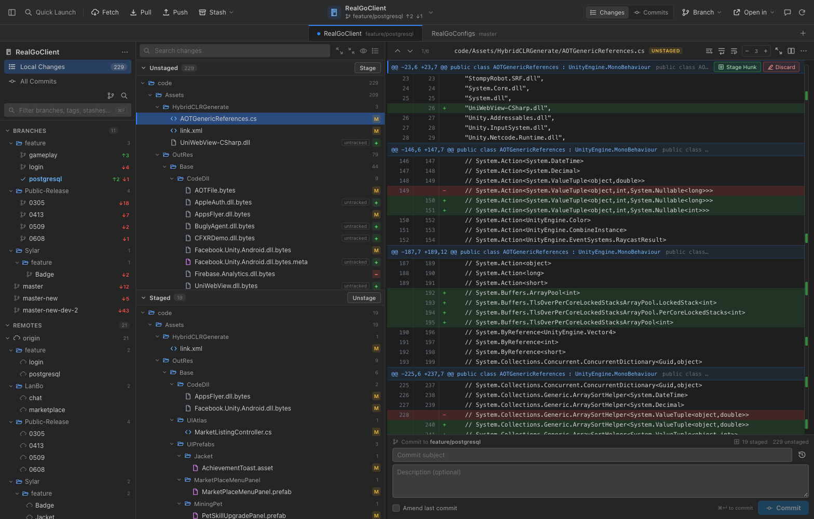
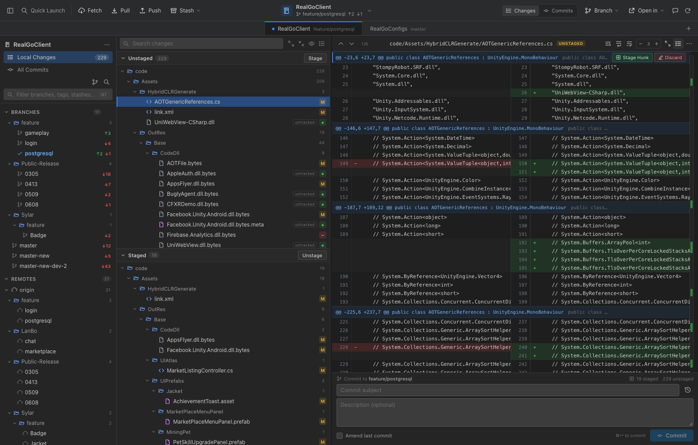
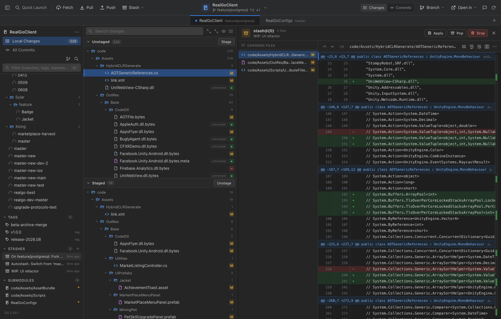
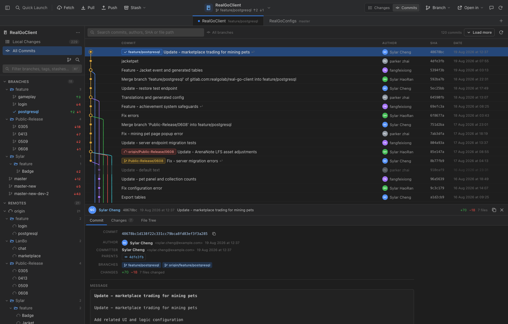
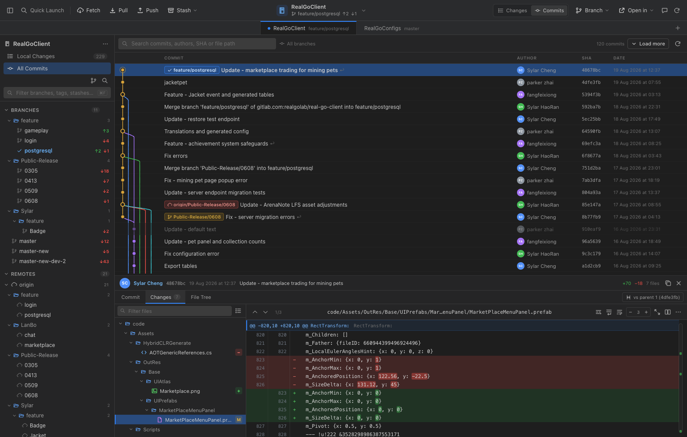

# ForkGit · VSCodeGitExtension

> A Fork-level Git experience inside VS Code.

ForkGit is a VS Code extension that brings the most useful workflows of desktop Git clients such as [Fork](https://git-fork.com/) into the editor: grouped branches, visual staging, line- and hunk-level commits, a commit graph, stash, tags and submodule management. No more switching between VS Code and an external Git client.



> Current version **0.1.0**. The screenshots are generated from the built-in mock preview (`npm run dev:web`) with sample data.

## Contents

- [Features](#features)
- [VS Code integration](#vs-code-integration)
- [Architecture](#architecture)
- [Project layout](#project-layout)
- [Development](#development)
- [Commands and shortcuts](#commands-and-shortcuts)
- [Configuration](#configuration)
- [Testing](#testing)
- [Roadmap](#roadmap)
- [Known limitations](#known-limitations)
- [License](#license)

---

## Features

### Branches
- Local and remote branches are grouped into folders by their `/` prefix (`feature/`, `Public-Release/`, ...)
- Ahead / behind counts relative to the upstream branch
- Single-click a branch to show its commits, double-click to check it out
- Context menu: checkout, merge, rebase, create a branch from here, rename, delete, push, set upstream
- Remote branches create a local tracking branch on checkout
- Branch filter in the sidebar; optional autostash when switching branches

### Local changes
- Separate **Unstaged** and **Staged** sections with tree and flat-list modes
- Status badges: `M` modified, `+` added / untracked, `−` deleted, `R` renamed, `C` conflicted
- Click a file to preview its diff; double-click or press `Space` to stage / unstage
- Multi-select and batch stage, unstage or discard
- Drag files between the staged and unstaged sections
- Discard changes, add to `.gitignore`, show in Finder / Explorer
- Commit box with subject, description, amend and recent commit messages

### Diff viewer
- Unified and side-by-side layouts
- **Stage or discard by hunk or by line**
- Previous / next hunk navigation and a change minimap
- Show whitespace, line endings, word wrap, configurable context lines and full-file mode
- Inline word-level diff highlighting, useful for Unity `.prefab` and YAML changes
- Binary file handling and side-by-side image comparison
- Guard against stale hunks: changing a file outside the extension is detected before a patch is applied



### Commits
- Subject and description fields with a subject-length hint
- **Amend** fills in the previous commit message
- Recent commit message picker
- Hook failures are reported through the notification and the ForkGit output channel

### Remote sync
- Fetch, pull (merge or rebase) and push, including `--force-with-lease`
- Multiple remotes
- Autostash for pull, merge, rebase and branch checkout
- Set upstream, push the current branch and delete remote branches
- Progress, error and conflict reporting

### Stash
- Stash tracked changes, including untracked files, or staged changes only
- Preview, apply, pop and drop
- Autostash before checking out another branch



### Tags
- Create lightweight or annotated tags
- Push, delete, check out and copy tags
- Tag badges in commit history

### Submodules
- Display submodules in a tree, marking dirty submodules with `*`
- Update, initialize and open a submodule in a new repository tab

### Commit history
- Commit graph with colored lanes and hollow nodes for merge commits
- Columns: graph, message and refs, author, short SHA, date
- **Ref badges**: current branch with a check mark, local-only branches in yellow, remote-only branches in red, tags
- Commits outside the current `HEAD` history are dimmed; commits with a body show `↩`
- Search by message, author, SHA or file path
- Incremental paging with virtual scrolling



### Commit details
- **Commit / Changes / File Tree** tabs and a draggable panel
- Commit metadata with full SHA, author, committer, clickable parents, branches and tags
- Changes tab with a changed-file tree, per-parent comparison, word diff, open file at revision, file history and blame
- File Tree tab with a full repository snapshot at that revision, filtering and opening files at the revision



### Quick Launch and extension entry points
- `⌘⌥P` / `Ctrl+Alt+P` opens a native Quick Pick for branches, commands and repositories
- A ForkGit view in the Activity Bar links to Local Changes, All Commits, Branches, Remotes, Tags, Stashes and Submodules
- The status bar shows the current branch, ahead/behind counts and changed-file count; click it to open the panel

---

## VS Code integration

Fork is a standalone macOS application with a top-level menu bar. **VS Code extensions cannot add top-level application menus**, so ForkGit places the complete Fork layout into a single `WebviewPanel`:

| Fork area | How ForkGit provides it |
|---|---|
| Top toolbar | Webview toolbar: Quick Launch, Fetch, Pull, Push, Stash, repository/branch picker, Branch, Open in, Feedback |
| Repository tabs | Webview repository tabs when multiple repositories are open |
| Left sidebar (Branches / Remotes / Tags / Stashes / Submodules) | Collapsible Webview sidebar. On narrow panels it becomes a drawer opened from the toolbar |
| Unstaged / Staged files | Webview change list with tree / flat mode, multi-select and drag and drop |
| Diff viewer | Webview diff viewer with unified / split mode, hunk and line operations, minimap |
| Commit area | Webview commit box at the bottom |
| Commit history and details | Webview history view with a draggable detail panel |
| Top-level application menus | Command Palette, Activity Bar tree view, toolbar dropdowns and context menus |
| Multiple repositories | Activity Bar tree view and repository tabs in the Webview |
| Quick Launch | Native VS Code `QuickPick` |
| Status and progress | `StatusBarItem`, `withProgress` and a Webview busy indicator |

When the editor panel is narrow (for example, when the Git panel is in a split editor group), ForkGit automatically hides the internal sidebar, compresses the columns and keeps the diff and commit areas usable. The sidebar button in the top-left corner opens branches, tags and stashes at any time.

---

## Architecture

| Layer | Implementation |
|---|---|
| Language | TypeScript |
| Git access | `git` CLI through `child_process.spawn`, plus repository change events from the built-in `vscode.git` API |
| Parsing | `git status --porcelain=v2 -z`, `git for-each-ref`, `git log --format`, `git diff --patch` |
| Partial staging | Parse unified diffs, compute the new index / worktree text, write a blob with `git hash-object -w` and update the index with `git update-index --cacheinfo` |
| Webview UI | React 18 + Vite, styled with VS Code theme variables |
| Commit graph | Custom lane layout, SVG rendering and virtual scrolling |
| Communication | Typed `postMessage` protocol in `src/protocol/types.ts` |
| Tests | Vitest (parsers, patches, graph, real temporary repositories) and `@vscode/test-electron` (real extension host) |
| Packaging | esbuild + `@vscode/vsce` |

### Why partial staging does not use `git apply`

Hunk- and line-level staging must work when both the index and the working tree already contain changes. Applying a generated patch with `git apply --cached` is fragile because line numbers can shift. ForkGit instead:

1. Parses the current `index -> worktree` diff (staging) or `HEAD -> index` diff (unstaging).
2. Applies the selected lines to the index text or worktree text.
3. Writes the result as a blob with `git hash-object -w`.
4. Updates the index with `git update-index --cacheinfo`.

This keeps unrelated staged and unstaged changes intact.

---

## Project layout

```
VSCodeGitExtension/
├── src/
│   ├── extension.ts              # activate / deactivate, commands, status bar, watchers
│   ├── protocol/
│   │   └── types.ts              # typed extension <-> webview protocol
│   ├── git/
│   │   ├── GitCli.ts             # git command wrapper
│   │   ├── Repository.ts         # repository state, diffs, history, hunk staging
│   │   ├── GitService.ts         # multi-repo support, operation queue, Quick Pick, notifications
│   │   ├── graph.ts              # commit graph lane layout
│   │   ├── patch.ts              # text patch application
│   │   └── parsers/
│   │       ├── status.ts
│   │       ├── diff.ts
│   │       └── refs.ts
│   ├── panels/
│   │   └── MainPanel.ts          # webview host and message dispatch
│   └── views/
│       └── NavigatorTree.ts      # Activity Bar tree view
├── webview-ui/
│   ├── index.html
│   └── src/
│       ├── App.tsx
│       ├── styles.css
│       ├── components/           # Toolbar, Sidebar, Changes, Diff, History, ...
│       ├── utils/                # file tree, formatting, word diff
│       └── mock/                 # browser mock data and message bridge
├── test/
│   ├── parsers.test.ts
│   ├── patch.test.ts
│   ├── graph.test.ts
│   ├── repository.test.ts        # integration tests against a real temporary repository
│   └── vscode/                   # @vscode/test-electron extension host test
├── docs/images/                  # README screenshots
├── media/                        # icons and built webview assets
├── package.json
├── esbuild.js
├── vite.config.ts
└── vitest.config.ts
```

---

## Development

### Requirements
- Node.js 20 or newer
- VS Code 1.90 or newer
- Git 2.30 or newer

### Run locally

```bash
npm install
npm run build

# Open the project in VS Code and press F5 to start the Extension Development Host
```

ForkGit scans the workspace, plus the repositories detected by the built-in Git extension. Run **ForkGit: Open Git Panel** from the Command Palette, click the ForkGit icon in the Activity Bar, or press `⌘⌥G` / `Ctrl+Alt+G`.

### Scripts

| Script | Purpose |
|---|---|
| `npm run build` | Build the webview (Vite) and the extension (esbuild) |
| `npm run build:webview` | Build only the webview |
| `npm run build:extension` | Build only the extension |
| `npm run watch` | Rebuild the extension entry point on change |
| `npm run dev:web` | Start the mock UI at `http://localhost:5173/?mock=1` |
| `npm run typecheck` | Type-check the extension and the webview |
| `npm test` | Run the Vitest unit and integration tests |
| `npm run test:vscode` | Run the real VS Code extension host test (downloads VS Code 1.95.3 for testing) |
| `npm run package` | Build and create the `.vsix` package |

### Mock UI

The webview ships with mock data and a mock message bridge, so the UI can be developed in a browser without starting VS Code:

```bash
npm run dev:web
# open http://localhost:5173/?mock=1
```

The mock supports view switching, staging, hunk staging, committing, stash actions and branch checkout, which makes visual iteration fast.

---

## Commands and shortcuts

| Command ID | Name | Default shortcut |
|---|---|---|
| `forkgit.open` | ForkGit: Open Git Panel | `Ctrl+Alt+G` / `⌘⌥G` |
| `forkgit.quickLaunch` | ForkGit: Quick Launch | `Ctrl+Alt+P` / `⌘⌥P` |
| `forkgit.fetch` | Fetch | — |
| `forkgit.pull` | Pull | — |
| `forkgit.push` | Push | — |
| `forkgit.stash` | Stash Changes | — |
| `forkgit.createBranch` | New Branch | — |
| `forkgit.refresh` | Refresh | — |
| `forkgit.openRepository` | Open Repository… | — |
| `forkgit.showHistory` | Show All Commits | — |

In-panel shortcuts:

| Shortcut | Action |
|---|---|
| `⌘ + Enter` / `Ctrl + Enter` | Commit |
| `Space` | Stage / unstage selected files (or the whole section when nothing is selected) |
| `⌘ + 1` / `⌘ + 2` | Local Changes / All Commits |
| `Esc` | Close a context menu or clear a filter |

Deep links:

```
vscode://forkgit.forkgit/open
vscode://forkgit.forkgit/open?section=branches
vscode://forkgit.forkgit/open?section=stashes
vscode://forkgit.forkgit/open?section=commits
```

---

## Configuration

| Setting | Type | Default | Description |
|---|---|---|---|
| `forkgit.changes.viewMode` | `"tree" \| "list"` | `"tree"` | How changed files are displayed |
| `forkgit.diff.mode` | `"unified" \| "split"` | `"unified"` | Default diff layout |
| `forkgit.diff.contextLines` | `number` | `3` | Context lines shown around changes |
| `forkgit.diff.showWhitespace` | `boolean` | `false` | Show whitespace characters by default |
| `forkgit.diff.wordWrap` | `boolean` | `false` | Wrap long diff lines |
| `forkgit.branches.groupByPrefix` | `boolean` | `true` | Group branches into folders by `/` prefix |
| `forkgit.pull.rebase` | `boolean` | `false` | Use rebase when pulling |
| `forkgit.checkout.autoStash` | `boolean` | `true` | Autostash before checkout, pull, merge and rebase |
| `forkgit.fetch.autoInterval` | `number` | `0` | Automatic fetch interval in minutes (0 disables) |
| `forkgit.gitPath` | `string` | `""` | Custom git executable path; empty uses `git` on `PATH` |
| `forkgit.confirmDestructiveActions` | `boolean` | `true` | Confirm destructive operations |
| `forkgit.history.pageSize` | `number` | `300` | Number of commits loaded per page |

---

## Testing

```bash
npm test
```

Coverage includes:

- `git status --porcelain=v2` parsing (branch headers, staged/unstaged, rename, conflict, untracked)
- Unified diff parsing (multiple hunks, renames, binaries, synthetic untracked files)
- Text patch application (forward / reverse, line selection, CRLF, stale context)
- Commit graph lane layout (linear, merge, parallel branches)
- Integration tests against real temporary repositories: status, hunk stage / unstage / discard, line staging, untracked file staging, commit / amend, stash, tags, rename, commit details, file tree and empty repositories

Real VS Code extension host test:

```bash
npm run test:vscode
```

This starts an isolated VS Code 1.95.3, loads the extension and verifies command registration, webview panel creation, view switching and repository refresh.

---

## Roadmap

### v0.1 — Local changes and commits
- [x] Extension scaffold and webview panel
- [x] `git status` parsing and staged / unstaged tree
- [x] File-level stage, unstage and discard
- [x] Unified diff viewer
- [x] Commit and amend

### v0.2 — Branches and remotes
- [x] Branches / remotes with prefix grouping and ahead/behind counts
- [x] Checkout, create, delete and rename branches
- [x] Fetch, pull, push and force-with-lease
- [x] Toolbar and repository / branch picker

### v0.3 — Fine-grained operations
- [x] Hunk- and line-level staging and discarding
- [x] Side-by-side diff, whitespace display and context-line controls
- [x] Stash and tag management
- [x] Quick Launch

### v0.4 — History and advanced features
- [x] Commit graph, ref badges and HEAD-relative dimming
- [x] Commit details (Commit / Changes / File Tree)
- [x] Word-level diff highlighting
- [x] Cherry-pick, revert, reset and branch rebase
- [x] Submodule view
- [~] Merge conflict assistance (conflicted files are shown and commits are blocked; no built-in ours/theirs picker yet)
- [ ] Interactive rebase UI
- [ ] Commit details in a separate window

### v1.0 — Release
- [~] Large-repository performance (virtualized history, collapsed large change trees; the change tree is not virtualized yet)
- [~] Multiple repositories and workspaces (repository tabs and Activity Bar tree; inactive repositories refresh on demand)
- [ ] Internationalization
- [x] `.vsix` packaging

---

## Known limitations

- **No top-level menus**: every action lives in the webview toolbar, context menus, Command Palette or Activity Bar.
- **Interactive rebase**, a **separate commit-details window** and a **conflict ours/theirs picker** are not implemented.
- Very large change sets (more than 800 files) start with collapsed folders; the change list is not virtualized yet. The history list is virtualized.
- External Git operations refresh through the built-in `vscode.git` API; inactive repositories refresh when selected.
- Network operations rely on the system Git credential helper. Interactive terminal prompts are disabled (`GIT_TERMINAL_PROMPT=0`), so credentials must be configured in a terminal or credential helper first.
- Image diffs are enabled for binary image files up to 12 MB.
- Commit templates are currently the recent-message picker; `.gitmessage` templates are not read.

---

## Contributing

Issues and pull requests are welcome:

1. Fork the repository and create a branch: `git checkout -b feature/xxx`
2. Commit your changes: `git commit -m "feat: xxx"` (Conventional Commits are recommended)
3. Push and open a pull request

---

## Acknowledgements

The interface and interaction design are inspired by [Fork](https://git-fork.com/). ForkGit is an independent open-source extension and is not affiliated with Fork or its developers.

## License

[MIT](./LICENSE)
